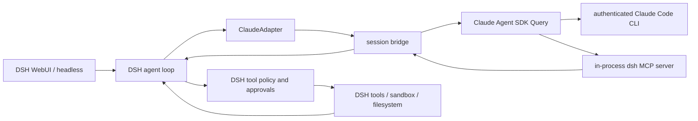
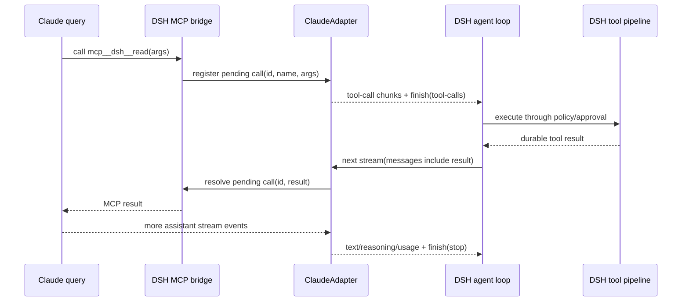

# Proposal: Claude Code as a first-class DSH model route

Status: proposed
Owner: snowan
Implementation: original work in `dsh-claude-plugin`

## Decision

Build an installable DSH bundle whose Cordis plugin registers a `claude-code`
`LlmAdapter`. The adapter keeps one Claude Agent SDK streaming query per live
DSH session, runs the user's authenticated Claude Code executable through DSH's
managed subprocess layer, and translates Claude output into DSH stream chunks.

DSH remains the harness. Claude Code supplies model inference and its supported
session transport; it does not independently execute filesystem, shell, MCP, or
plugin actions.

## Goals

- Make `claude-code / default` selectable anywhere DSH selects a model.
- Preserve DSH's existing agent loop, prompt assembly, tools, permissions,
  sandbox, persistence, telemetry, cancellation, and WebUI.
- Reuse the host's normal `claude auth login` state without reading secrets.
- Stream text, reasoning, usage, and tool calls with UI fidelity.
- Support multi-step and multi-tool turns without restarting Claude for every
  DSH step.
- Fail closed when a permission, process, schema, replay, or protocol state is
  ambiguous.
- Install and remove through the normal DSH profile plugin workflow.
- Be independently authored, testable without paid API use in CI, and
  verifiable through authenticated local end-to-end tests.

## Non-goals for the first stable release

- Replacing DSH's agent loop with Claude Code's native loop.
- Enabling Claude's native filesystem, shell, browser, hook, skill, plugin,
  subagent, or ambient MCP configuration.
- Copying or wrapping DSH's existing Claude subagent implementation.
- Supporting interactive terminal UI mode.
- Persisting an in-flight MCP tool handler across a host process crash.
- Claiming exact behavioral parity with direct Claude Code before benchmarks
  establish it.

## System boundary



| Concern | Authority |
| --- | --- |
| Model selection and inference | Claude Code through Agent SDK |
| Prompt and projected conversation | DSH request, translated by adapter |
| Tool catalog | DSH scoped tool registry |
| Tool decision | Claude model |
| Tool authorization and execution | DSH tool pipeline |
| Durable transcript and replay | DSH session log |
| Claude transport context | Per-session SDK query |
| Process lifecycle | DSH subprocess provider |
| Authentication | Host Claude Code installation |
| Web presentation | Existing DSH stream/session APIs |

## Package shape

```text
dsh-claude-plugin/
├── cordis.patch.yml
├── package.json
├── src/
│   ├── index.ts                 # Cordis plugin and config schema
│   ├── adapter.ts               # LlmAdapter implementation
│   ├── bridge.ts                # one live bridge per DSH session
│   ├── input.ts                 # DSH -> SDK message translation
│   ├── output.ts                # SDK -> DSH stream translation
│   ├── tool-server.ts           # dynamic in-process MCP server
│   ├── pending-tools.ts         # pause/resume correlation state
│   ├── process.ts               # executable resolution and managed spawn
│   ├── models.ts                # aliases and model resolution
│   ├── usage.ts                 # token/cost mapping
│   ├── errors.ts                # stable public diagnostics
│   └── doctor.ts                # runtime readiness checks
├── tests/
│   ├── fixtures/
│   ├── unit/
│   ├── contract/
│   └── e2e/
└── docs/
```

The public npm package name is `dsh-claude-plugin`; the DSH provider ID is
`claude-code`. The bundle patch inserts exactly the adapter row and a narrowly
scoped model-route patch. It does not replace tools, security policy, sessions,
or UI rows.

## Configuration

```ts
interface Config {
  /** Host executable name or absolute path. Default: "claude". */
  claudeCommand?: string

  /** Prefer host CLI; optionally fall back to the SDK-bundled executable. */
  executablePolicy?: 'host-only' | 'host-then-bundled' | 'bundled-only'

  /** Aliased Claude model used by the provider's `default` entry. */
  defaultModel?: 'sonnet' | 'opus' | 'haiku' | string

  /** Idle lifetime for a session bridge. */
  sessionIdleMs?: number

  /** Maximum time a pending DSH tool round trip may remain unresolved. */
  toolRoundTripTimeoutMs?: number

  /** Graceful process shutdown before forced tree termination. */
  shutdownGraceMs?: number

  /** Additional environment keys explicitly forwarded to Claude. */
  passEnv?: string[]

  /** Emit transport diagnostics without prompt or credential contents. */
  debug?: boolean
}
```

Configuration validation rejects non-positive bounds, unsafe environment names,
empty commands, and unsupported policy values before an adapter is registered.
No option enables Claude native tools in the first release.

## Model catalog

The provider advertises stable aliases:

- `default` — maps to `Config.defaultModel`, initially `sonnet`;
- `sonnet`;
- `opus`;
- `haiku`.

It also accepts an explicit Claude model name. Aliases are resolved by Claude
Code rather than frozen to dated model identifiers. A model change on an idle
bridge calls the SDK's supported model setter; a change during an active
generation is queued for the next request or rejected with a stable diagnostic,
never applied halfway through output.

## Session bridge

`BridgeManager` owns a map keyed by DSH `sessionId`. A bridge contains:

- one async input queue of `SDKUserMessage` values;
- one live SDK `Query` iterator;
- one background pump and adapter event queue;
- current generation state;
- current Claude session ID and selected model;
- a pending-tool registry;
- an abort controller and managed process handle;
- the cumulative usage snapshot and consumed-prefix fingerprint;
- last-used time and cleanup state.

Creation is lazy on the first request. A background pump is the sole consumer of
the SDK query and persists across DSH `stream()` calls. Each call drains a
generation-scoped adapter event queue until its DSH finish boundary. Concurrent
calls for the same session are serialized. A different DSH session never shares
a query, pending tool entry, pump, or mutable prompt state.

Idle bridges are evicted after the configured lifetime. Plugin disposal aborts
all queries, rejects every pending tool promise, closes input queues, and waits
for DSH subprocess cleanup.

## Request translation

### Initial request

1. DSH calls `stream()` with the system prompt, projected messages, current
   scoped tools, session ID, model, and abort signal.
2. The adapter creates or validates the session bridge.
3. It installs the exact DSH tool catalog in the bridge's MCP server.
4. It starts the SDK query with a custom system prompt and isolated settings.
5. It starts the bridge pump and enqueues the new DSH-visible user content as an
   SDK user message.
6. `stream()` drains translated adapter events until normal completion or the
   current DSH tool boundary; it does not own or close the SDK iterator.

### Tool pause and resume



The MCP handler deliberately remains pending while DSH executes the tool. The
adapter does not send a second user message for that tool result: it resolves
the original MCP request, allowing the same Claude turn to continue.

The background pump remains alive at this boundary. It naturally parks while
the SDK awaits the unresolved MCP promise; the next DSH `stream()` call resolves
the correlated tool results and drains the continued output from the same
query. Returning `finish(tool-calls)` must never close or abandon that query.

Before accepting the next DSH step, the adapter requires an exact correlation
between pending calls and durable tool results. Unknown, duplicate, missing, or
already-resolved IDs produce a protocol error and tear down the bridge.

### Multiple tools

Claude may propose multiple independent tool calls in one assistant response.
The adapter emits every call before the terminal `tool-calls` finish chunk. DSH
executes them according to its own scheduling rules. The next step resolves all
matching pending calls; the Claude query continues only after each promised MCP
result settles. Mixed success/error results are preserved per call.

## Dynamic DSH MCP server

DSH tools already provide JSON Schema. Converting arbitrary schemas to Zod can
lose constraints, so the preferred implementation uses the MCP SDK's low-level
`tools/list` and `tools/call` request handlers with raw schemas. A guarded
fallback converts only a tested JSON Schema subset and rejects unsupported
schemas at catalog installation.

Tool names are exposed under one in-process server as `mcp__dsh__<name>`. The
original DSH name and call ID are retained in bridge metadata so WebUI and
session events show the DSH identity, not an MCP-qualified alias.

Catalog updates are generation-scoped: a request sees one immutable snapshot.
The next DSH request may replace it after no Claude tool request is in flight.

## SDK isolation

Every query starts with the following policy:

- `tools: []` — no Claude built-in tools;
- `mcpServers: { dsh: inProcessServer }`;
- `allowedTools: ["mcp__dsh__*"]`;
- `strictMcpConfig: true`;
- no filesystem setting sources;
- no Claude plugins or SDK skills;
- custom DSH system prompt instead of Claude Code's coding-agent prompt;
- fail-closed permission, elicitation, and user-dialog callbacks;
- browser/IDE integrations disabled;
- cwd set to the DSH request workspace;
- executable spawned through `ctx.subprocess`.

The custom SDK spawn hook wraps DSH's `SubprocessHandle` as the Node-like
`SpawnedProcess` expected by the SDK, including stdin/stdout, exit/error events,
state, and `kill()` mapped to managed termination. Environment forwarding starts
from an allowlist needed for executable startup and authentication. SDK-provided
environment entries are filtered before explicit additions so they cannot
reintroduce sensitive or `DSH_*` values removed by the subprocess service. The
adapter never logs environment values.

## Stream translation

The translator is a state machine, not a collection of best-effort event
handlers. It enforces one open block at a time per content index and emits:

| Claude SDK message/block | DSH output |
| --- | --- |
| assistant text delta | `block-start`, `text-delta`, `block-end` |
| thinking delta | reasoning block/delta/end |
| DSH MCP `tool_use` | correlated DSH tool-call chunks |
| result usage | DSH disjoint input/output/cache token buckets |
| successful result | terminal `finish(stop)` |
| pending DSH tools | terminal `finish(tool-calls)` for this DSH step |
| max-token result | terminal `finish(max-tokens)` |
| cancellation | abort error classified as cancellation |
| SDK/process failure | typed adapter failure with safe diagnostic |

With `includePartialMessages: true`, raw partial stream events are authoritative
for text, thinking, tool-input deltas, and message-stop boundaries. Completed
assistant messages reconcile IDs and block structure but do not re-emit content.
Exactly one terminal finish chunk is emitted for a successful DSH step.

SDK result `modelUsage` is cumulative across turns. The bridge snapshots the
per-model counters, sums them, subtracts the prior snapshot, and emits only the
non-negative delta for the current DSH step. A negative delta indicates a new
session epoch or incompatible event sequence and invalidates the bridge rather
than undercounting silently. Raw SDK events, prompts, tool outputs, and
credential paths are excluded from default logs.

## History, resume, and compaction

DSH's session log is the durable source of truth. Claude transport state is an
optimization that must agree with the DSH-visible conversation.

For a live bridge, the adapter sends only admitted new user input and resolves
pending MCP calls; Claude retains its transport context. After each successful
step, replay state records a version, Claude session identifier, safe transcript
or fork identifier when available, consumed DSH-prefix fingerprint, model, and
cumulative usage snapshot.

An exact cold resume is allowed only when the current projected prefix matches
the replay fingerprint. A DSH fork may use Claude's supported fork/session
resume only when the exact stored transcript identifier is safe for that prefix.
An in-flight pending tool cannot be reconstructed after a crash and fails
explicitly.

The SDK rejects arbitrary assistant-role messages in streaming input, so
compacted, imported, or otherwise divergent history uses a new Claude query with
a canonical, length-bounded transcript envelope derived entirely from the DSH
projection. The envelope labels roles, tool IDs, results, and replay mode. If
the projection cannot be represented within configured limits, the adapter
fails with `COLD_REPLAY_UNSUPPORTED`; it never silently trusts stale Claude
context or pretends the replay was lossless.

## Cancellation and failure recovery

- A DSH abort signal interrupts the SDK query and terminates its managed process
  tree after the grace period.
- A caller abort rejects pending MCP handlers with a stable cancellation result.
- Unexpected CLI exit invalidates the entire bridge; the next request uses an
  eligible exact resume or an explicit degraded replay from DSH history.
- Malformed SDK events fail the generation and preserve the last durable DSH
  events; they are never silently skipped.
- Tool timeout reports the call ID/name, tears down the bridge, and leaves DSH's
  durable result available for diagnosis.
- Plugin unload waits for cleanup and does not leave a Claude child process.

Retries are permitted only before assistant output or a tool call becomes
observable. Once output is emitted, an automatic replay could duplicate text or
side effects and is forbidden.

## Doctor and installation experience

The package exposes a doctor command/library that checks, without reading
secrets:

1. DSH and peer package compatibility;
2. host executable resolution;
3. `claude --version` minimum compatibility;
4. `claude auth status` account metadata;
5. managed process startup and shutdown;
6. in-process MCP catalog/call handshake;
7. a keyless fixture generation;
8. an explicit authenticated live generation probe as the conclusive readiness
   check.

The README will document:

```bash
dsh plugin --profile web add /absolute/path/to/dsh-claude-plugin
dsh --profile web --dump-config
dsh web --profile web
```

Removal uses the matching DSH plugin command and leaves no copied credential or
session files.

## Compatibility policy

- Develop against DSH `0.1.1-rc.2` and Claude Agent SDK `0.3.241`.
- Declare DSH packages as peer dependencies with a tested prerelease range;
  never rely on npm's stale `latest` tag for DSH subpackages.
- Pin the Agent SDK within a tested minor line and use Dependabot/Renovate-style
  updates only through compatibility PRs.
- Run contract tests against the lowest and newest allowed versions.
- Detect the runtime Claude CLI version and produce an actionable error below
  the tested minimum; a newer CLI is accepted only after the SDK initializes.

## Acceptance criteria

The first stable release is complete only when all of these are proven:

1. DSH discovers `claude-code` models and can select one in WebUI.
2. An authenticated Claude Code CLI produces streaming text through DSH.
3. A real DSH filesystem or shell tool call appears in WebUI, passes through
   DSH approval/policy, returns to Claude, and the same turn completes.
4. Multi-tool success and mixed-error cases preserve IDs and results.
5. Cancellation leaves no Claude process and no unresolved promise.
6. Session continuation works across multiple user turns; a cold restart
   rebuilds context from DSH history without duplication.
7. Images, reasoning, usage, and tool error content have contract coverage.
8. The plugin installs/removes through a DSH profile without modifying DSH
   source or unrelated profile security rows.
9. CI has keyless deterministic tests; authenticated local E2E results are
   recorded separately with exact versions and commit.
10. Direct Claude versus DSH+plugin benchmarks report success, latency, token
    usage, and observed behavioral gaps.
11. Every implementation task lands through its own tested PR.
12. `git shortlog -sne --all` and GitHub's contributors API show only snowan.

## Rejected alternatives

### Use DSH's Claude subagent as the parent model

Rejected because it registers on `ctx.subagents`, lacks primary LLM streaming
semantics, and does not preserve the parent DSH session/tool loop.

### Spawn a fresh `claude -p` for each DSH step

Rejected because it loses the live MCP pause/resume call, increases latency, and
makes tool-result correlation depend on replaying partial history.

### Let Claude Code execute its native tools

Rejected because it bypasses DSH's permission, sandbox, persistence, telemetry,
and WebUI boundaries and can double-execute tools.

### Implement the Anthropic Messages API directly

Rejected because the requirement is to use the authenticated Claude Code
product/CLI, not require a separate API key or recreate Claude Code transport.

### Copy another adapter and rename its protocol

Rejected for both technical and provenance reasons. Codex app-server, Claude
stream-json, and Agent SDK queries have different lifecycle and tool semantics;
this repository requires a clean original implementation.
